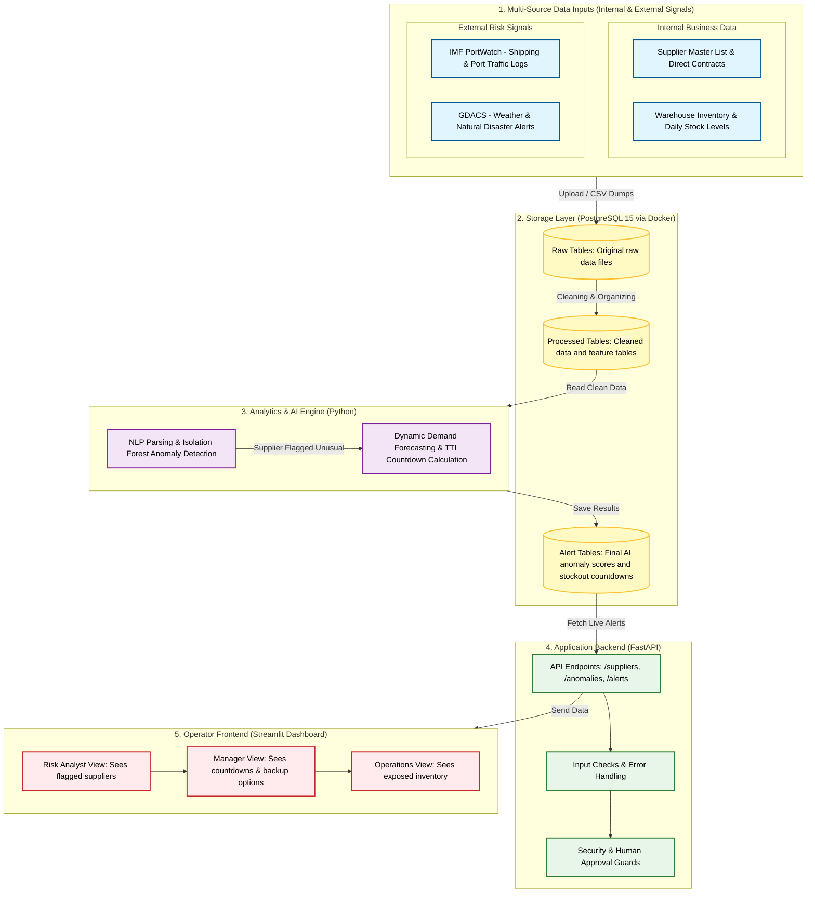

# SupplyPulse: AI-Driven Supply Chain Disruption Early-Warning Platform
**Comprehensive Master Plan & Detailed Execution Blueprint**

**Academic Context:** Mid-Semester & Final Review under Prof. Vanita Babbane (Vishwakarma Institute of Technology, Pune)  
**Portfolio Rank:** Rank #8 in Fujitsu Data & AI Portfolio (Score: 9.1 / 10)  
**Team Members:** Pradymna Adhari, Omkar Akhade, Vishal Amrutkar, and Pravin Bolshette  

---

## 1. Executive Summary & Problem Identification

### The Core Problem
Traditional supply chain management systems suffer from a "Tier-1 Blind Spot." Enterprises typically track only their direct suppliers (Tier-1) and rely on reactive firefighting when shortages occur. They lack a unified early-warning system that fuses real-world external risks (like severe weather events and port congestion) with internal operational stock realities to predict stockouts before they halt production.

### The Solution: SupplyPulse
SupplyPulse is an automated, AI-driven early-warning and time-to-impact forecasting platform. It operates on a multi-source data strategy—combining internal business data (supplier master contracts and warehouse inventory levels) with external risk signals (weather/disaster alerts and shipping port logs)—to calculate exact countdown timelines and suggest verified mitigation actions.

---

## 2. Core Functional Pillars (The 4 Pillars of Intelligence)

SupplyPulse integrates four core technical pillars to deliver end-to-end supply chain resilience:

1. **Natural Language Processing (NLP):**
   * **Purpose:** Parses unstructured external risk alerts (e.g., GDACS natural disaster notices, weather bulletins, and news feeds).
   * **Mechanism:** Extracts critical metadata such as affected regions, disaster types (cyclone, flood, earthquake), and unstructured severity descriptions to transform raw text into structured risk features.

2. **Risk Analytics:**
   * **Purpose:** Quantifies supplier vulnerability across multiple dimensions.
   * **Mechanism:** Combines unsupervised anomaly scores from Scikit-learn's Isolation Forest with external port congestion delays to compute a unified **Composite Risk Score (0 to 100)** for every supplier.

3. **Dynamic Demand Forecasting:**
   * **Purpose:** Anticipates inventory depletion accurately under varying operational conditions.
   * **Mechanism:** Tracks warehouse daily consumption rates and production demand shifts to dynamically project precise stockout timelines rather than relying on static estimates.

4. **Automated Alert Engine:**
   * **Purpose:** Proactively notifies stakeholders before disruptions impact manufacturing.
   * **Mechanism:** Automatically flags high-risk suppliers, records alerts in the database, exposes them via REST endpoints, and surfaces warning badges on the operator dashboard.

---

## 3. Minimum Viable Product (MVP) Scope & Boundaries

### In-Scope (For Mid-Sem & Final Review):
1. **Multi-Source Data Ingestion:** Importing CSV dumps and public benchmark data (IMF PortWatch, GDACS, inventory logs) into PostgreSQL 15.
2. **Phase 1 (Anomaly Detection & Risk Analytics):** Unsupervised anomaly detection on supplier delivery times, shipping metrics, and order volumes using Scikit-learn.
3. **Phase 2 (Time-to-Impact / TTI Calculation):** A deterministic inventory depletion formula linking stock levels and daily consumption rates to output exact stockout countdown days.
4. **Actionable Recommendations:** Automated mapping of pre-configured backup suppliers to help managers bypass disruptions.
5. **Application Stack:** FastAPI backend service paired with a Streamlit operator dashboard tailored for the Supply Chain Risk Analyst persona.

### Out-of-Scope (Deferred or Prohibited):
* Complex multi-tier graph propagation (NetworkX graph traversal removed to focus entirely on direct supplier anomaly detection and inventory tracking).
* Fully autonomous financial decision-making (AI generates recommendations and countdowns, but a human user—the Procurement Manager—must manually approve any supplier switch, adhering to Responsible AI safety guidelines).

---

## 4. User Personas & Decision Chain

SupplyPulse is designed around a clear operational decision chain:
1. **Supply Chain Risk Analyst (Primary User):** Opens the dashboard, reviews the anomaly score, and sees which suppliers are flagged with plain-language reasons.
2. **Procurement / Planning Manager:** Checks the time-to-impact countdown (e.g., "Stock critical in 4 days") and evaluates the suggested backup supplier contract.
3. **Operations / Production Head:** Views high-level factory and product exposure summaries to adjust manufacturing schedules.

---

## 5. PostgreSQL 15 Database Schema & Migration Script

The database is divided into clean raw ingestion layers (`raw_*`) and processed business tables (`proc_*`) across five relational domains. Below is the exact initialization migration script (`init_schema.sql`):

```sql
-- SupplyPulse Core Relational Schema Initialization Script

-- 1. Suppliers Table
CREATE TABLE IF NOT EXISTS suppliers (
    supplier_id TEXT PRIMARY KEY,
    supplier_name TEXT NOT NULL,
    country TEXT NOT NULL,
    backup_supplier_name TEXT
);

-- 2. Inventory Levels Table
CREATE TABLE IF NOT EXISTS inventory_levels (
    record_id SERIAL PRIMARY KEY,
    facility_id TEXT NOT NULL,
    sku_id TEXT NOT NULL,
    current_stock_units INT NOT NULL,
    daily_consumption_rate FLOAT NOT NULL,
    stockout_flag BOOLEAN DEFAULT FALSE
);

-- 3. Port Activity Table
CREATE TABLE IF NOT EXISTS port_activities (
    activity_id SERIAL PRIMARY KEY,
    port_name TEXT NOT NULL,
    date DATE NOT NULL,
    congestion_delay_days FLOAT NOT NULL
);

-- 4. External Disruption Table (NLP Parsed Inputs)
CREATE TABLE IF NOT EXISTS external_disruptions (
    event_id TEXT PRIMARY KEY,
    event_type TEXT NOT NULL, -- e.g., Cyclone, Flood, Port Strike
    affected_region TEXT NOT NULL,
    severity_score FLOAT CHECK (severity_score >= 0.0 AND severity_score <= 10.0)
);

-- 5. AI Disruption Alerts Table (Output of Anomaly Detection & TTI)
CREATE TABLE IF NOT EXISTS disruption_alerts (
    alert_id SERIAL PRIMARY KEY,
    supplier_id TEXT REFERENCES suppliers(supplier_id),
    anomaly_score FLOAT NOT NULL,
    is_flagged BOOLEAN DEFAULT FALSE,
    predicted_tti_days INT NOT NULL,
    recommended_action TEXT NOT NULL,
    created_at TIMESTAMP DEFAULT CURRENT_TIMESTAMP
);
```

---

## 6. System Architecture Diagram



---

## 7. Step-by-Step Detailed Project Execution Plan

### **Group 1: Data & AI Engine**

1. **Database Setup & Provisioning:**
   * Initialize a persistent PostgreSQL 15 Docker container using `docker-compose.yml`.
   * Execute the `init_schema.sql` migration script to provision the 5 core relational tables.
   * Verify table creation and foreign key constraints via `psql`.

2. **ETL Pipeline & Data Ingestion:**
   * Build modular Python ingestion scripts (`etl/extract.py`, `etl/transform.py`, `etl/load.py`) using Pandas and SQLAlchemy.
   * Ingest raw benchmark CSV dumps (IMF PortWatch shipping data, GDACS disaster bulletins, internal warehouse inventory logs).
   * Clean missing values, normalize timestamps (`YYYY-MM-DD`), and load structured features into PostgreSQL.

3. **Phase 1 AI Model — Isolation Forest Anomaly Detection & NLP:**
   * Implement an unsupervised Scikit-learn `IsolationForest` model (`phase1_detection/train_model.py`) trained on delivery variance, shipping delays, and order volume drops.
   * Integrate a lightweight NLP parsing module to extract disaster types, affected regions, and severity scores from unstructured external text logs.
   * Run inference scripts (`detect.py`) to generate continuous anomaly scores (`-1.0` to `1.0`) and flag high-risk suppliers.

4. **Phase 2 Analytics — Dynamic Demand Forecasting & TTI Calculation:**
   * Implement the time-to-impact calculation module (`phase2_prediction/tti_calculator.py`).
   * Apply the mathematical depletion formula:
     $$\text{Predicted TTI (Days)} = \frac{\text{Current Stock Units}}{\text{Daily Consumption Rate}}$$
   * Dynamically adjust daily consumption rates using demand forecasting trends, and map flagged risks to pre-configured backup suppliers.

---

### **Group 2: Backend & Frontend Dashboard**

1. **FastAPI Backend Skeleton & Endpoints:**
   * Structure the FastAPI application with clean routers (`/suppliers`, `/anomalies`, `/alerts`).
   * Implement strict Pydantic validation schemas to guarantee robust JSON request/response handling.
   * Add global error handlers, middleware, and request audit logging.

2. **Streamlit Operator Dashboard Construction:**
   * Build an intuitive multi-tab operator web interface (`streamlit_app/app.py`).
   * **Tab 1:** Live Disruption Alerts & Executive Summary.
   * **Tab 2:** Supplier Risk Inspector & Anomaly Score breakdown.
   * **Tab 3:** Inventory Levels & TTI Stockout Countdown view.
   * **Tab 4:** Scenario Simulation Sandbox (interactive sliders for port delays and weather shocks).

3. **Responsible AI Guardrails & Human-in-the-Loop:**
   * Enforce explicit confirmation dialogs in the UI whenever a user acknowledges an alert or triggers a mitigation action.
   * Ensure the AI system acts strictly as an advisory recommendation engine—never executing financial transactions or supplier switches autonomously.
   * Log all operator override decisions into an immutable audit table in PostgreSQL.

4. **Dockerization & Final Packaging:**
   * Write production-ready Dockerfiles for both the FastAPI backend and Streamlit frontend services.
   * Update `docker-compose.yml` to orchestrate all three containers (`postgres`, `backend`, `frontend`) into a single unified deployment stack.
   * Finalize project documentation (`README.md`, Data Dictionary, and User Evaluation Guide).