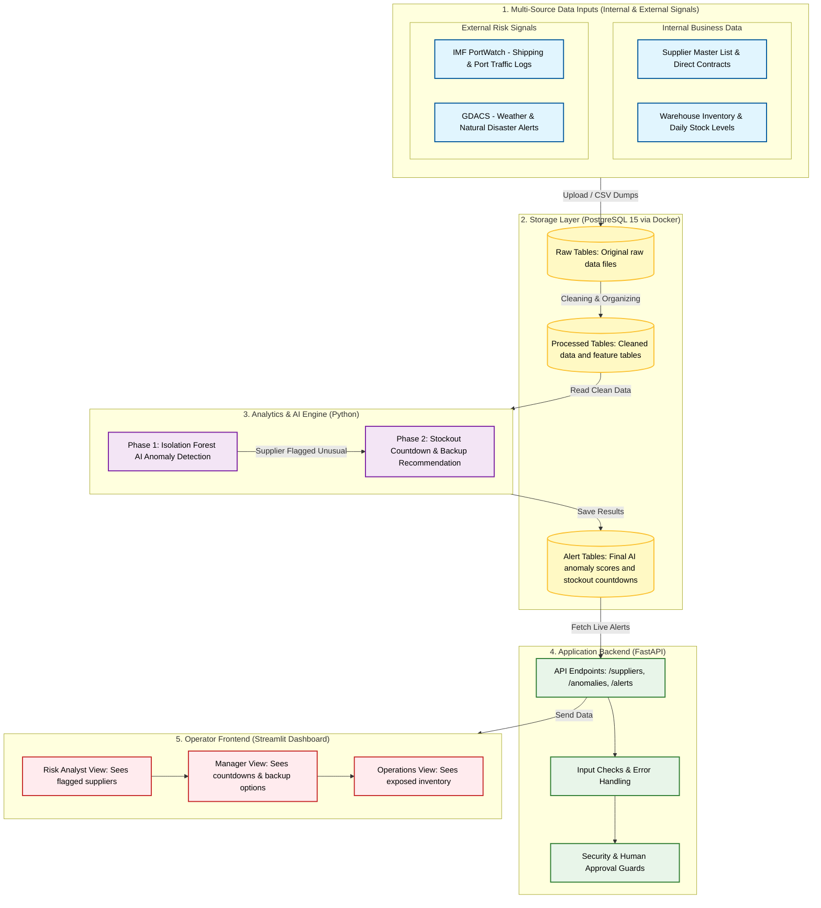

# SupplyPulse AI — Master Project Planning, Architecture & Implementation Plan

**Project Title:** SupplyPulse: AI-Driven Supply Chain Disruption Early-Warning Platform  
**Academic Context:** Mid-Semester & Final Review under Prof. Vanita Babbane (Vishwakarma Institute of Technology, Pune)  
**Portfolio Rank:** Rank #8 in Fujitsu Data & AI Portfolio (Score: 9.1 / 10)  
**Team Members:** Pradymna Adhari, Omkar Akhade, Vishal Amrutkar, and Pravin Bolshette  

---
---

# 1. Executive Summary & Problem Identification

## 1. Problem Statement
> Traditional supply chain management systems suffer from a **"Tier-1 Blind Spot."** Companies typically track only their direct suppliers (Tier-1) and rely on reactive firefighting when shortages occur, lacking a unified early-warning system that fuses real-world external risk signals with internal operational inventory states.

## 2. Why the Standard Architecture Fails
Standard supply chain architectures operate in silos: ERP systems track static inventory numbers, while external monitoring tools track weather or shipping news independently. Without a unified fusion pipeline, organizations cannot calculate the compounding effect of external disruptions (such as port congestion or severe weather) on specific internal manufacturing dependencies until the stockout has already halted factory operations.

## 3. Technical Impact & Risk
In a high-stakes manufacturing or procurement environment, a delayed warning means factory shutdowns, breached customer SLAs, and massive financial loss. The practical risk is that disruptions are noticed only *after* inventory hits zero, turning predictable supply chain vulnerabilities into full-blown operational crises.

## 4. MVP Solution & Boundaries
SupplyPulse bridges this gap by providing an automated, AI-driven early-warning and time-to-impact forecasting platform. It operates on a multi-source data strategy—combining internal business data (supplier master contracts and warehouse inventory levels) with external risk signals (weather/disaster alerts and shipping port logs)—to calculate exact countdown timelines and suggest verified mitigation actions.

---
---

# 2. Minimum Viable Product (MVP) Scope & Boundaries

## In-Scope (For Mid-Sem & Final Review)
1. **Multi-Source Data Ingestion:** Importing CSV dumps and public benchmark data (IMF PortWatch, GDACS, inventory logs) into PostgreSQL 15.
2. **Phase 1 (Isolation Forest Anomaly Detection):** Unsupervised anomaly detection on supplier delivery times, shipping metrics, and order volumes using Scikit-learn to flag unusual supplier behavior.
3. **Phase 2 (Time-to-Impact / TTI Calculation):** A deterministic inventory depletion formula linking stock levels and daily consumption rates to output exact stockout countdown days.
4. **Actionable Recommendations:** Automated mapping of pre-configured backup suppliers to help managers bypass disruptions.
5. **Application Stack:** FastAPI backend service paired with a Streamlit operator dashboard tailored for the Supply Chain Risk Analyst persona.

## Out-of-Scope (Deferred or Prohibited)
- Complex multi-tier graph propagation (NetworkX graph traversal removed to focus entirely on direct supplier anomaly detection and inventory tracking).
- Fully autonomous financial decision-making (AI generates recommendations and countdowns, but a human user—the Procurement Manager—must manually approve any supplier switch, adhering to Responsible AI safety guidelines).

---
---

# 3. User Personas & Decision Chain

SupplyPulse is designed around a clear operational decision chain:
1. **Supply Chain Risk Analyst (Primary User):** Opens the dashboard, reviews the anomaly score, and sees which suppliers are flagged with plain-language reasons.
2. **Procurement / Planning Manager:** Checks the time-to-impact countdown (e.g., *"Stock critical in 4 days"*) and evaluates the suggested backup supplier contract.
3. **Operations / Production Head:** Views high-level factory and product exposure summaries to adjust manufacturing schedules.

---
---

# 4. PostgreSQL 15 Database Schema

The database is divided into clean raw ingestion layers (`raw_*`) and processed business tables (`proc_*`) across five relational domains:

1. **Suppliers Table (`suppliers`):**
   - `supplier_id` (Text, Primary Key)
   - `supplier_name` (Text)
   - `country` (Text)
   - `backup_supplier_name` (Text)
2. **Inventory Table (`inventory_levels`):**
   - `record_id` (Integer)
   - `facility_id` (Text)
   - `sku_id` (Text)
   - `current_stock_units` (Integer)
   - `daily_consumption_rate` (Float)
   - `stockout_flag` (Boolean)
3. **Port Activity Table (`port_activities`):**
   - `activity_id` (Integer)
   - `port_name` (Text)
   - `date` (Date)
   - `congestion_delay_days` (Float)
4. **External Disruption Table (`external_disruptions`):**
   - `event_id` (Text)
   - `event_type` (Text — e.g., `Cyclone`, `Flood`)
   - `affected_region` (Text)
   - `severity_score` (Float, 0.0 to 10.0)
5. **AI Disruption Alerts Table (`disruption_alerts`):**
   - `alert_id` (Integer)
   - `supplier_id` (Text)
   - `anomaly_score` (Float, Isolation Forest output)
   - `is_flagged` (Boolean)
   - `predicted_tti_days` (Integer)
   - `recommended_action` (Text)

---
---

# 5. System Architecture Diagram

---
---

# 6. Implementation & Execution Plan

